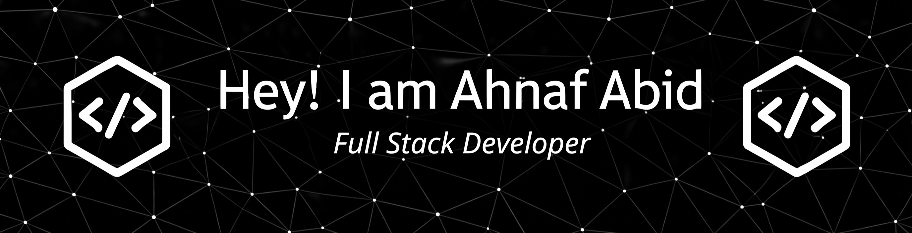

I am Ahnaf Abid, a web developer focused on full-stack products. I enjoy building clean and responsive web applications.

I'm open to work and new opportunities (remote).

Besides programming, I have an interest in content creation.

# 💫 More About Me:
🔭 I’m currently working on a SaaS Product 🌱 I’m exploring Prisma 💡 I love learning new technologies and improving my skills every day.  
🎯 I aim to create web apps that solve real-world problems. 👯 I’m open to collaborating on any interesting project.  📫 How to reach me: ahnaf@abidnirob.com

# 🚀 My Startups:
1. [ShareThreado](https://sharethreado.com) — A space for creators and builders to share what they're making, spark fresh ideas, and connect with the people who truly get it.

## 🌐 Socials:
     

# 💻 Tech Stack

### 🎨 Frontend Development

### ⚙️ Backend Development

### 🗄️ Database & Backend Services

### ☁️ Cloud, Hosting & Deployment

### 🤖 AI Tools

### 🛠️ Tools & Design

# 📊 GitHub Stats:
 
 

## 🏆 GitHub Trophies

### ✍️ Random Dev Quote

### 🔝 Top Contributed Repo

---

<!-- Proudly created with GPRM ( https://gprm.itsvg.in ) -->
